Notes from my talk at Leading Design London, 11 November 2026. Slides and speaker notes, lightly edited for reading.

<figure class="slide">
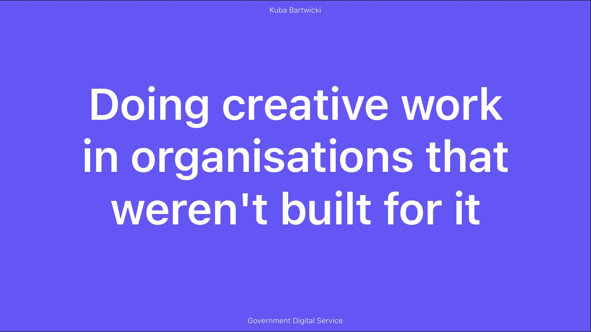
</figure>

Hello, I’m Kuba, and I’ll be talking today about doing creative work in organisations that weren’t built for it

I’m a designer. The job of a designer is creative because it involves making, inventing, producing

I do it because I love how it feels to hold or use a thing that I made with other people, which encapsulates a million decisions and ideas

I do it because I want the things that we interact with in everyday life to be ‘good’, to solve real problems, to feel amazing to interact with

I have a benchmark of what ‘good’ looks like, informed by lots of experience, design training, understanding human behaviour

I sell my services to the UK government, and I’m passionate about how to make institutions like this better places to do design in, and I think it’s absolutely vital that we do if we want technology to work for people

First though, we all need to ask ourselves – what do good conditions for doing design actually look like?

<figure class="slide">
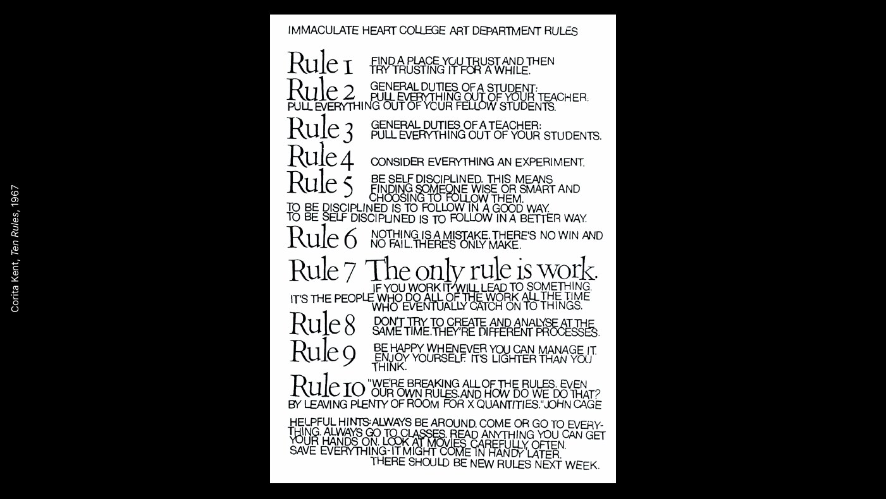
<figcaption>Corita Kent, Ten Rules, 1967</figcaption>
</figure>

This is my favourite list of them. I’m sure we all have one. This is from Corita Kent, who taught at an arts college in LA, and captured these in the 60s. They’re quite famous

What I like:

Rule 1: “Find a place you trust, and then try trusting it for a while.” Designing something new requires leaps of faith, and risk-taking, and trust. To me, this is about the need for an environment where those things are safe, and encouraged

Rule 7: “The only rule is work.” Designing something new requires getting stuck in. Most problems we’re working on in institutions like the government are highly complex. They are things we DISCOVER solutions to, and it’s impossible to define them upfront. You need to try, and take it one step at a time. To me, this is about some good practice from the tech world – start with an MVP, trust the process a little bit, and have a bias for optimism

I love this image, and use it often. That’s a benchmark for the conditions design work needs

<figure class="slide">
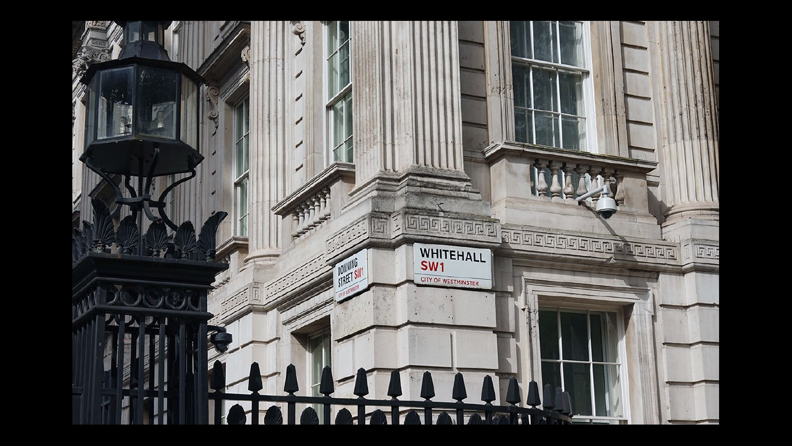
</figure>

BUT, I work in an organisation that really wasn’t built for this stuff

It was built for risk management, cost/benefit ratios, RDEL, CDEL, policy papers. It’s brilliant, and effective, but it is not a user-centred product organisation – and it’s important that it becomes one, if it is to deliver things that meet people’s needs

<figure class="slide">
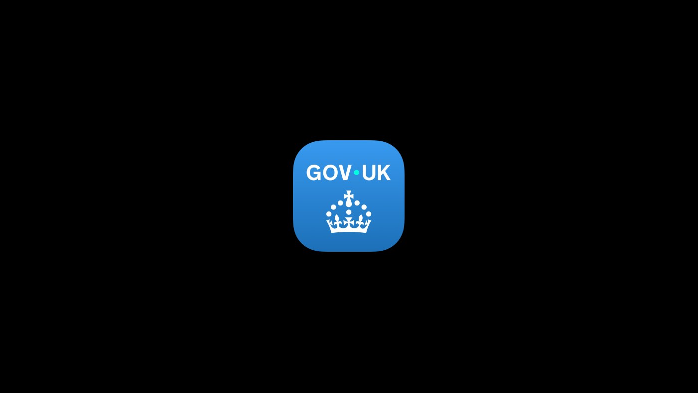
</figure>

… I head up a design team responsible for a major new front-door to all public services – the GOV.UK app. It’s been live for about a year, and we’re learning lots every day

It’s a rare opportunity to imagine and deliver a brand-new experience of government for everyone in the UK: one that’s personal to you, where you don’t have to repeat yourself, where we are proactively delivering services that you need. Much like you’re used to from other things you interact with in your daily life

<figure class="slide">
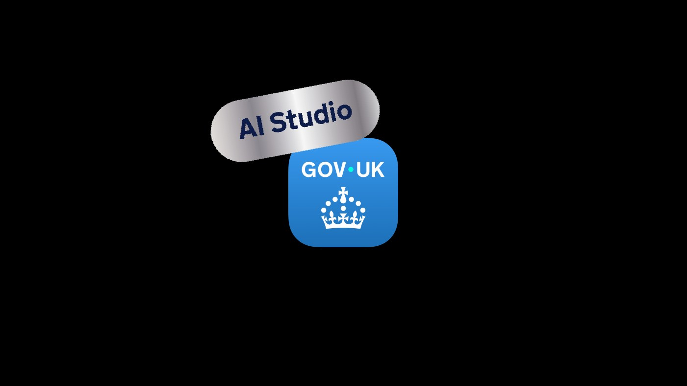
</figure>

I want to share a few examples of how I’m making it a better environment for design, most of which has started as pilots within a team called “AI Studio”

We’ve been piloting a forward-thinking, design-led approach to working out how agentic AI will impact the citizen experience of government, and designing new capabilities for the GOV.UK app

<figure class="slide">
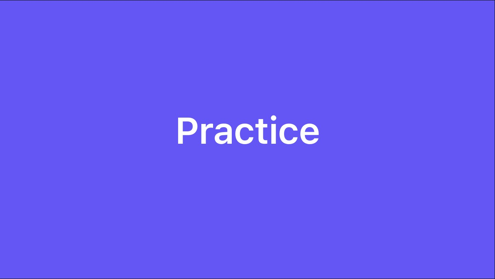
</figure>

I want to start with practice, how we actually make things, and why I believe it’s undergoing a big shift

<figure class="slide">
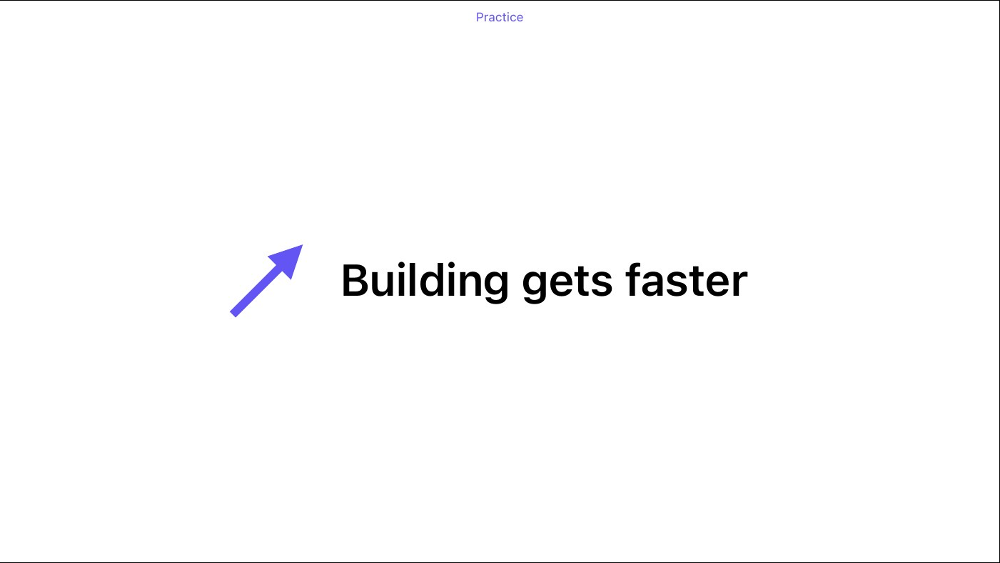
</figure>

The first shift is that making things on the internet is getting faster, despite complexity increasing. The tooling available to us is infinitely more powerful than the tooling from just 3 years ago

<figure class="slide">
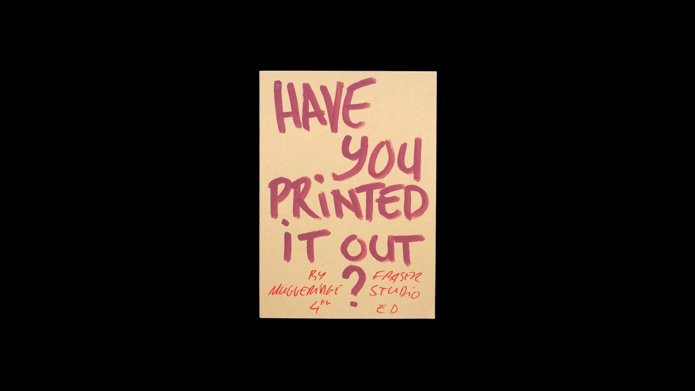
<figcaption>Have you printed it out? by Fraser Muggeridge Studio</figcaption>
</figure>

This is a book by Fraser Muggeridge, a tutor of mine at art school and an amazing graphic designer. It’s full of off-cuts, print tests and experiments: the things you make on the way to making something.

Early on he taught me that if you’re making a book or a poster, you print it out, early. You look at it from different sides, feel it, check its real size, show it to people. Once it’s a thing you can show, your conversations get so much better

So if our tooling becomes more powerful – that’s useful. We can build our ideas much, much faster. We can test them. We can feel things for real. And if we need to invent a whole lot of new things, that’s pretty useful

<figure class="slide">
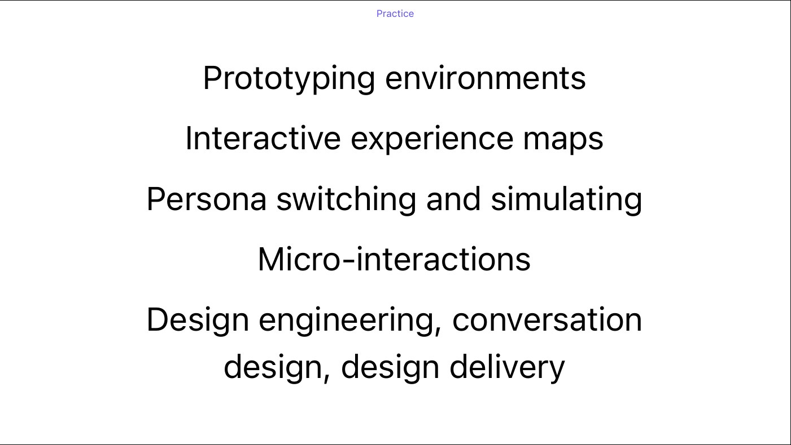
</figure>

We need to take our off-cuts more seriously, and work on our tooling

We’re seeing the need for shared prototyping environments just because of the complexity of the things designers make

Interactive maps that would previously be static murals

Dynamic back-ends that allow you to use conversational UI in interfaces

Persona switching and simulating

It’s new, and allows us to have greater impact, and make better UX decisions quicker

<figure class="slide">
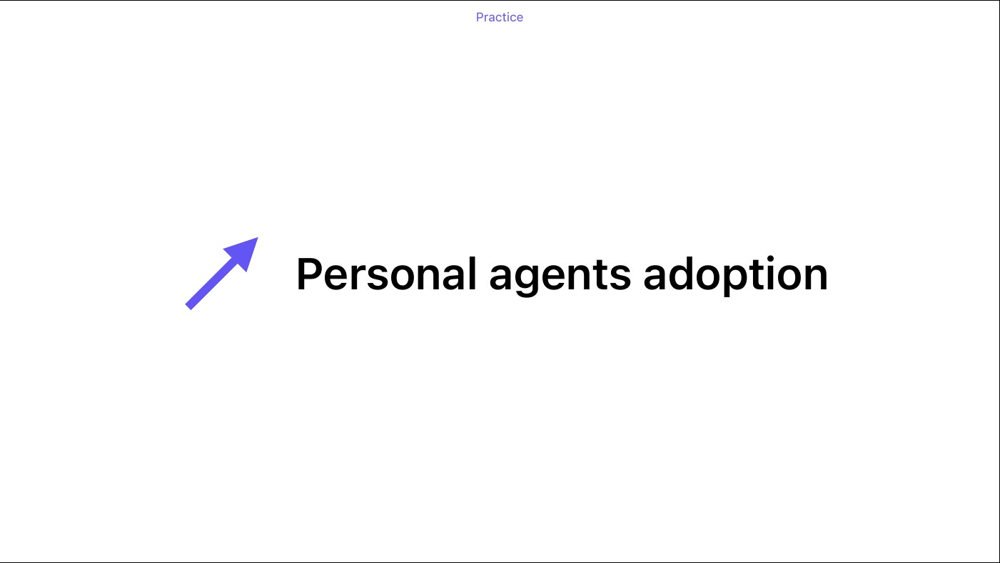
</figure>

The second shift is that personal agents, technology that promises to end it all and collapse all interfaces, is here, interacting with your products without you knowing. We need to prepare for this, and we need to invent other product categories that can and will exist

This is a really profound change: leading a design team through them is challenging, but exciting, and we have a responsibility to make it work for our users

<figure class="slide">
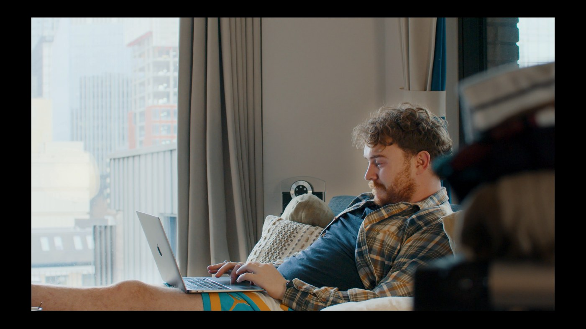
<figcaption>Still from speculative design work with Superflux</figcaption>
</figure>

To work out what to do, we are using prototyping: to demystify this complexity, and to ask better questions about what to do next

This is some speculative design work we did with Superflux

We had a bunch of workshops to think about the futures for education, work, civic engagement. Both as a hopeful future, and cautious ones

Here is a clip from the one about work – it’s showing a gig worker using personal agents to take shifts, and balancing that with his benefits. It’s not a policy proposal, it’s not an announcement – it’s just a scenario we brought to life to help us have better conversations

<figure class="slide">
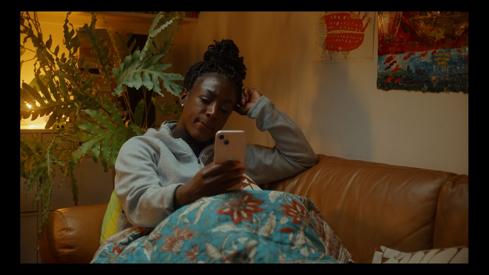
<figcaption>Still from speculative design work with Superflux</figcaption>
</figure>

Here is another one – a woman choosing school for her child, and working with a government agent to understand what’s best for her child

These have been enormously helpful in homing in on HUMAN IMPACT in conversations usually dominated by technology, governance, cost. It’s about design influencing at the highest level, with our bread and butter of great prototyping and storytelling

<figure class="slide">
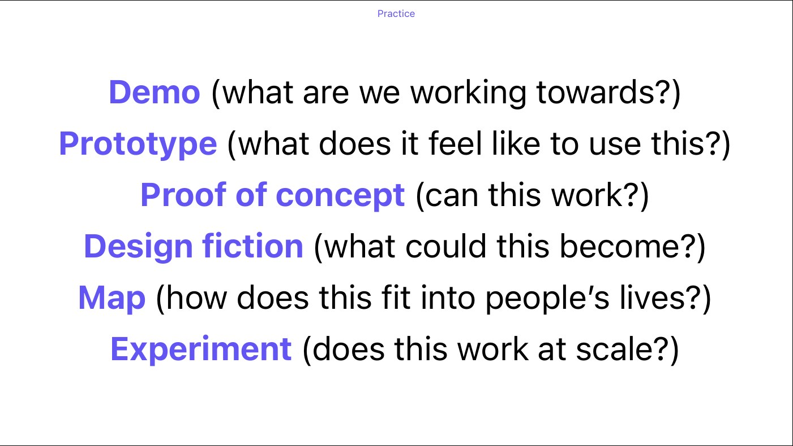
</figure>

Big institutions often suffer from an imagination bottleneck: it’s so hard to imagine otherwise, and to bring a different perspective to a problem.

Designers can break through it. We speak the language of images, so we can show new ways of doing things more clearly than most.

But now that anyone can make something, the skill is making the right thing, at the right time, for the right purpose. That starts with a more precise vocabulary. We call nearly all of it “a prototype”, but a director hears “nearly built”, an engineer hears “throwaway”, and a researcher hears “something to test”.

So here are six things we make at work, and the question each one answers. Begin with the question, then pick the word.

<figure class="slide">
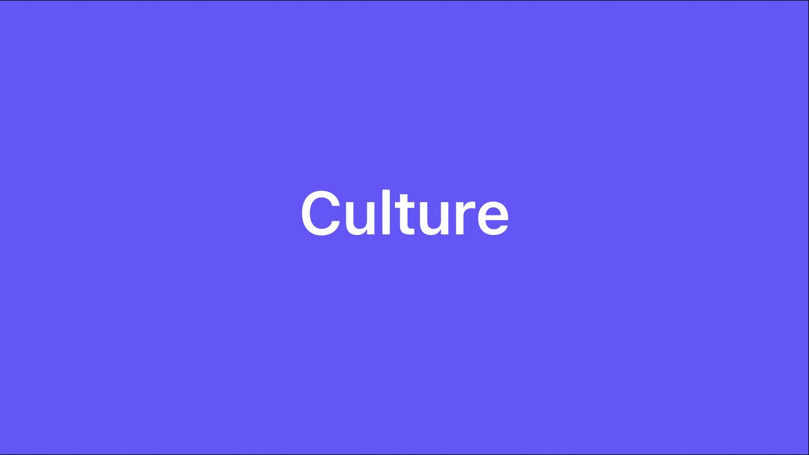
</figure>

… but! There is more to making great things than prototyping approaches. I want to talk about culture, how to set it up, and how to scale it

<figure class="slide">
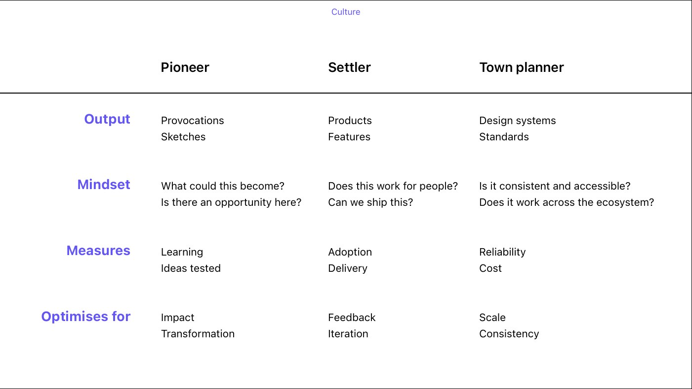
<figcaption>Adapted from Simon Wardley’s pioneers, settlers and town planners</figcaption>
</figure>

First of all, make sure you are hiring the right people

This is such a vital framework that I refer to all the time. It’s normally used in agile delivery circles, but I adapted it to design. It proposes that there are three different personality types, mindsets, and operational stages – pioneers, settlers, town planners. Sometimes they’re just a hat you put on, sometimes you are fundamentally one or the other – it depends.

What does it look like in design?

- Pioneers are brilliant. They will make provocations and sketches, and optimise for LEARNING and TRANSFORMATION over delivery or adoption
- Settlers are brilliant. They will take their beginnings and turn them into products and features. They will obsess over feedback loops, and delivery
- Town planners are brilliant. They will expand your impact across the entire ecosystem with design systems and standards

I am showing this because it’s helpful to think about this when building your design team

I want to propose that you really, really need pioneers right now – especially if you are building a new kind of design team, and trying to respond to change around you. Your pioneers can MAKE largely in absence of structure. You will need them to get this going. Hire for high-agency, high-creativity individuals

<figure class="slide">
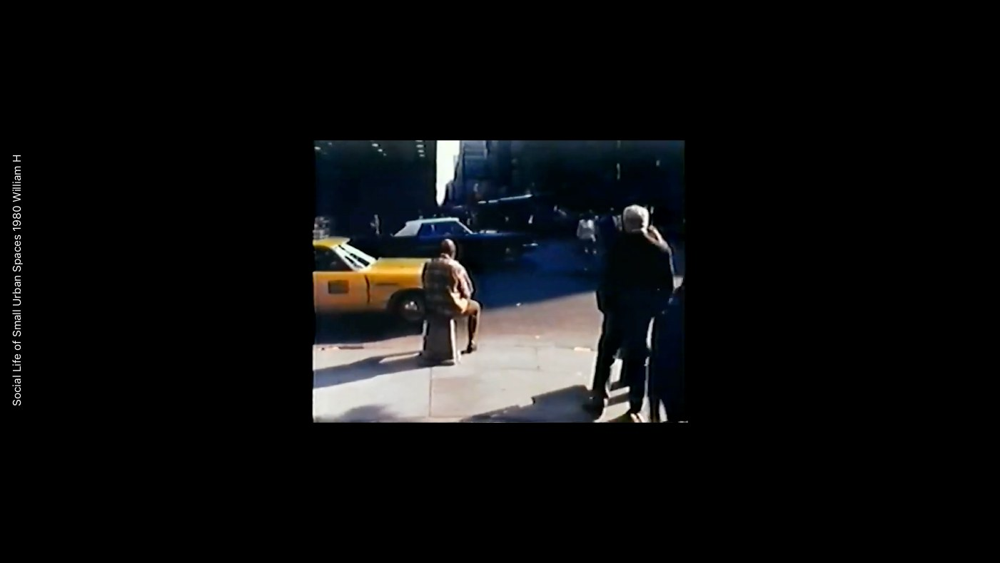
<figcaption>Still from The Social Life of Small Urban Spaces (1980), William H. Whyte</figcaption>
</figure>

So, you’ve got some pioneers in, and you want them to start making amazing, transformative things…

You need to structure your design team in ways that will enable them to do that – you need a design studio

This is a short GIF from a film called ‘The Social Life of Small Urban Spaces’ that’s a study of urban design

It shows people approaching a public space, moving chairs about, ignoring them, gently nudging them

And these behaviours change. Over time. Sometimes you get a say, sometimes not

GOOD STRUCTURE is one that maps most closely to how your products meet people. That’s it

You need to group teams according to what users are most likely to see to prevent Conway’s law

Designers need fluid setups. You need to reorganise. You need to form horizontals.

For that, you need a constant of a studio

<figure class="slide">
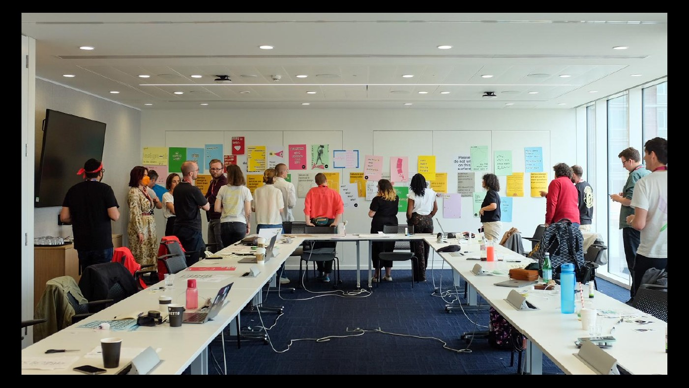
</figure>

Your studio is where you work across product lines, and build an environment of curiosity, collaboration, risk-taking, user-centredness

Your studio should meet in person quite a lot so that it can learn how to work together. I’m not sure how creative work can happen without a healthy dose of that

As we established, creative work requires a special set of conditions. Your job is to pay attention to it

Is there curiosity, or stagnation?

Are your teams talking about the WORK or about the PROCESS

Are people collaborating across teams, or sticking to their product surface? What is their ‘allegiance’?

Tweak your meeting formats

Lead them, don’t wait for it to all build organically

… That’s fine for designing at the right level, but how to actually influence delivery and decisions?

<figure class="slide">

</figure>

For that, you need some cross-cutting experience governance

In our AI Studio early days, we found ourselves making lots of experience decisions without certainty we are allowed to make them

Our solution was informal ‘design days’, where we invited directors along to discuss things like our approach to AI agents and voice interfaces

But our work on citizen experience goes far beyond AI: how do we scale it?

What is the most high-level place in your org where experience decisions are being taken? How many people are tasked with it? How many of them are designers?

If zero, it’s a problem – your job is to solve it

<figure class="slide">
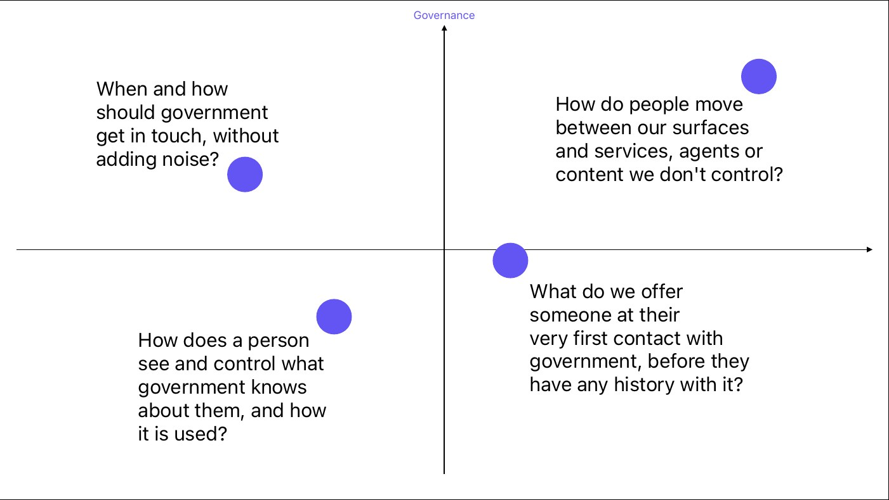
</figure>

Here is how we’re doing it

First, show the work

We wrote up a list of the kinds of questions we are asking a lot, and convinced stakeholders to start up some teams to explore them by talking about risks to adoption and UX coherence

We called them ‘experience missions’

<figure class="slide">
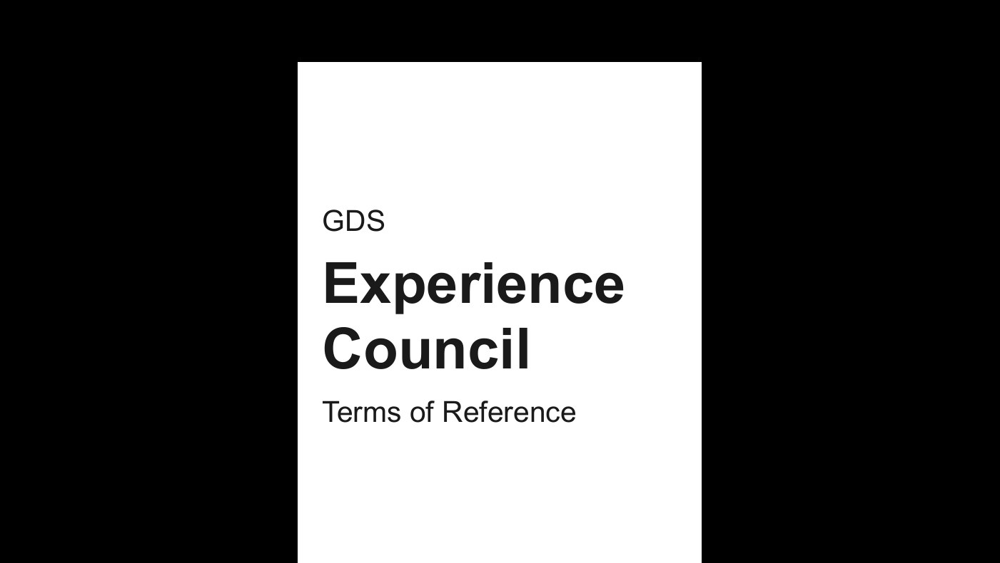
</figure>

Second, build a place where you can discuss it

Ours is called Experience Council. It’s got a terms of reference and is attended by most senior directors in the org

For the first council meeting, I commissioned a single deep dive – basically for a team to explore what is ideal UX for our proactive comms patterns

They made a recommendation to consolidate a few things. No product team would ever have been incentivised to accept it. We needed to create a new place

A few days later, it got merged

<figure class="slide">
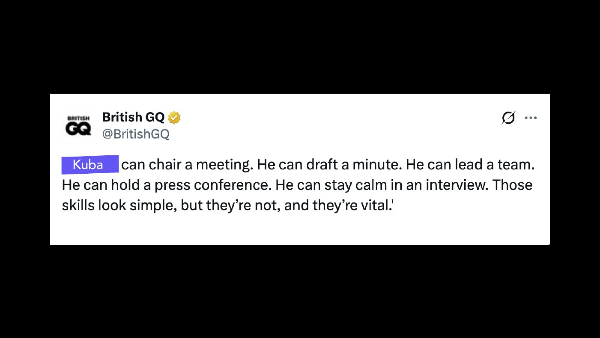
</figure>

You need to get into the messiness of governance

Your organisation is a slog of a thing, with multiple steering groups and boards and politics and all sorts of other stuff

You, as a design leader, need to show that you can work this. This tweet was originally about a certain ex-prime minister, but I found it quite funny – I obviously can’t do most of those things – but the premise of WORK THE ORG is important if you want your team to show up credibly

<figure class="slide">

<figcaption>Yves Klein, la révolution bleue (2006)</figcaption>
</figure>

But interestingly, you also kind of become a curator

Your job is to see the whole thing, and that only works if you stay close to the substance. You can’t decide what to escalate, what to crack on with or what to stop if you haven’t seen the prototypes and read the evidence. That’s hard, but it needs doing

If you do your job well, after your first few meetings – more people will care and pay attention

And bit by bit, you will make change

<figure class="slide">
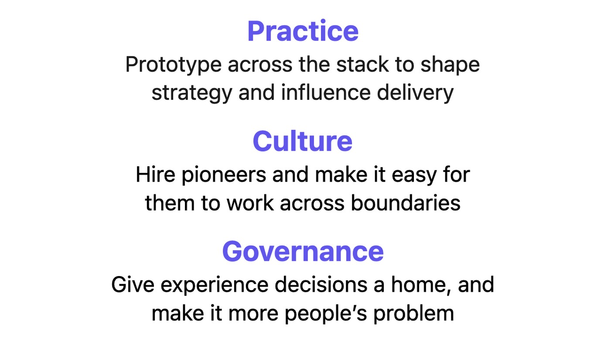
</figure>

Thank you so much for listening.
